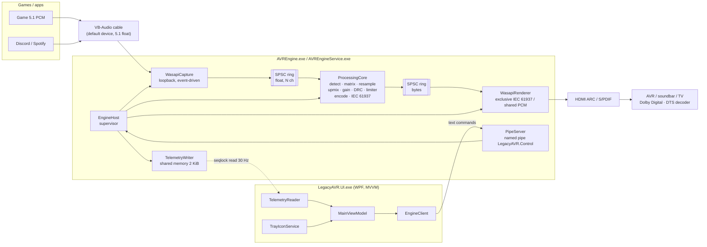
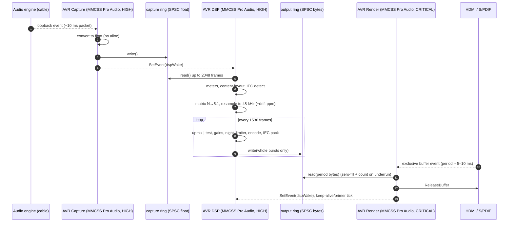
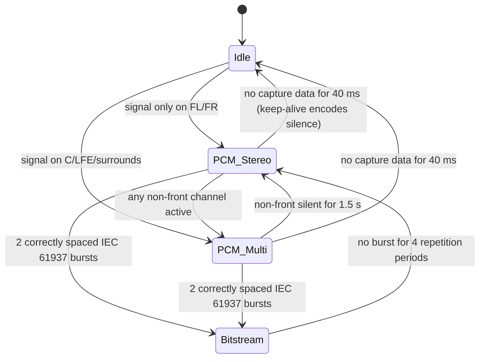

# LegacyAVR: Architecture Specification

LegacyAVR turns a Windows 11 PC into a software *Dolby Digital Live / DTS Interactive* encoder. Games and
apps render 5.1 PCM into a virtual cable (set to 5.1 since v1.6.0; a 7.1 cable is folded down). `AVREngine.exe` captures that cable with
WASAPI loopback, folds it down or upmixes it to a 5.1 bus, encodes it in real time with FFmpeg
`libavcodec`, wraps it in IEC 61937, and plays it through the HDMI ARC / S/PDIF device in WASAPI
exclusive mode. To the AVR, the result looks just like a Blu-ray player's bitstream.

---

## 1. Requirements and how they are met (including physical limits)

| Requirement | Implementation | Notes / limits |
|---|---|---|
| No kernel driver, Secure Boot stays on | VB-Audio cable configured as 5.1 (7.1 accepted and folded down) + WASAPI loopback | Uses signed third-party cable driver only. DD+ 7.1 encoding is being investigated but is not currently available |
| AC-3 640/448 kbps | `ac3` float encoder, FLTP, 5.1 or 2.0 | Bitrates snap to the AC-3 table (32..640k) |
| DTS 1509.75 / 754.5 kbps | `dca` encoder (FFmpeg *experimental*), 512-sample frames | 1509.75k → 2016-byte frames fit an IEC type-I burst *with* preamble |
| E-AC-3 (no longer experimental since v1.3.0) | `eac3` encoder, IEC 61937 @ 192 kHz transport | **Max 1.024 Mbps** (11-bit frame size). **Not possible over optical/coax S/PDIF** (bandwidth); needs an HDMI ARC sink that advertises DD+ |
| Exclusive bitstream output | `WAVEFORMATEXTENSIBLE_IEC61937` → `WAVEFORMATEXTENSIBLE` → `WAVE_FORMAT_DOLBY_AC3_SPDIF` fallback chain | Falls back to Shared PCM automatically with a UI warning if the device refuses |
| Shared "compatibility" mode | float32 48 kHz + `AUTOCONVERTPCM`, downmix to device channels | Exclusive mode locks **only the HDMI/S-PDIF device**. Discord/Spotify still play into the cable, so nothing is locked out in either mode |
| 96 kHz / 24-32-bit input | `libswresample` → 48 kHz, always engaged | Also used for clock-drift trim (§7) |
| IEC 61937 auto-detect (0xF872/0x4E1F) | `Iec61937Detector` on the first stereo pair | Requires a bit-transparent path: cable at 48 kHz, volume 100%, no enhancements |
| 1536-sample frame-aligned pipeline | `kBlockFrames = 1536` staging buffer | All DSP runs per AC-3 frame |
| **15–32 ms end-to-end** | — | **Not physically achievable.** One AC-3 frame is 1536/48000 = **32 ms** of accumulation *before* encoding can start. Realistic total: **~50–70 ms** + the AVR's decode (~20–50 ms). See §6 |
| CPU < 1 / 3 / 5 % | Measured by `LegacyAVR.Tests.exe --bench` | % of *one* core; expected well under target on any AVX2 CPU |
| Lock-free, zero-alloc audio threads | SPSC rings, atomics, preallocated buffers | One caveat for libavcodec, see §5 |
| MMCSS "Pro Audio" | Capture + DSP (HIGH), Render (CRITICAL) | Plus EcoQoS / timer-throttling opt-out |
| Process names | `AVREngine.exe`, `AVREngineService.exe`, `LegacyAVR.UI.exe` | Version resource sets the Task Manager description |

---

## 2. Component view



---

## 3. Class diagram

```mermaid
classDiagram
    class EngineHost {
        +initialise() bool
        +run(HANDLE stop)
        +requestRestart(reason)
        -startPipeline() bool
        -stopPipeline()
        -healthCheck()
        -handleCommand(line) string
        -publishTelemetry()
        -EngineConfig cfg_
        -LiveParams params_
    }
    class WasapiCapture {
        +open(deviceId, bufferMs) bool
        +start(ring, wake) bool
        +stop()
        +format() PcmFormatInfo
        +failed atomic~bool~
    }
    class WasapiRenderer {
        +open(deviceId, RenderRequest) bool
        +start(ring, wake) bool
        +stop()
        +periodBusFrames() uint
        +underruns atomic~uint~
    }
    class ProcessingCore {
        +configure(CoreConfig, LiveParams, in, out) bool
        +step(nowUs) bool
        +stats CoreStats
        +inputMeters MeterBank~8~
        +outputMeters MeterBank~6~
        -processBlock(planes, stereo)
        -forwardBitstream(frames)
    }
    class SpscRing~T~ {
        +allocate(n)
        +write(p, n) size_t
        +read(p, n) size_t
        +readAvailable() size_t
    }
    class ChannelMatrix { +configure(ch, mask) +apply(in, n, bus) }
    class Upmixer { +configure(UpmixSettings) +process(bus, n, mode) }
    class NightModeCompressor { +process(bus, ch, n) }
    class SafetyLimiter { +process(bus, ch, n) }
    class Resampler { +open(rate, ch, maxIn) +process() int +setCompensationPpm(ppm) }
    class DriftController { +update(fill) double }
    class AudioEncoder { +open(codec, bitrate, ch) bool +encodeBlock(planes, fn, user) bool }
    class Iec61937Detector { +feed(words, n) +locked() bool +type() IecType }
    class TestSignalGenerator { +render(mode, mask, bus, n) }
    class TelemetryWriter { +open(serviceMode) +publish(fill) }
    class PipeServer { +start(serviceMode, handler) +stop() }
    class LiveParams { atomics: gains, mutes, master, upmix, night, test }

    EngineHost *-- WasapiCapture
    EngineHost *-- WasapiRenderer
    EngineHost *-- ProcessingCore
    EngineHost *-- TelemetryWriter
    EngineHost *-- PipeServer
    EngineHost *-- LiveParams
    EngineHost *-- "2" SpscRing~T~
    ProcessingCore *-- ChannelMatrix
    ProcessingCore *-- Upmixer
    ProcessingCore *-- NightModeCompressor
    ProcessingCore *-- SafetyLimiter
    ProcessingCore *-- Resampler
    ProcessingCore *-- DriftController
    ProcessingCore *-- "2" AudioEncoder
    ProcessingCore *-- Iec61937Detector
    ProcessingCore *-- TestSignalGenerator
    ProcessingCore ..> LiveParams : reads per block
```



Source layout:

| Path | Contents | OS dependency |
|---|---|---|
| `engine/core/` | DSP, encoder, resampler, IEC 61937, rings, `ProcessingCore` | none (FFmpeg only), so it's unit-testable |
| `engine/ipc/` | `TelemetryLayout.h` (packed struct), `ControlProtocol` | none |
| `engine/win/` | WASAPI, MMCSS, shared memory, named pipe, SAPI, service host | Win32 / COM |
| `engine/app/` | `AVREngine.exe`, `AVREngineService.exe` entry points | Win32 |
| `ui/LegacyAVR.UI/` | WPF MVVM dashboard + tray | .NET 10 |
| `tests/` | native unit, integration and performance tests | |

---

## 4. Thread and lock-free pipeline model



| Thread | Priority | Owns | May allocate? | Blocking calls |
|---|---|---|---|---|
| AVR Capture | MMCSS Pro Audio HIGH | `IAudioCaptureClient`, capture ring producer | No | `WaitForMultipleObjects` only |
| AVR DSP | MMCSS Pro Audio HIGH, FTZ/DAZ | `ProcessingCore`, both ring ends it touches | Our code: no. libavcodec: tiny descriptors (§5) | `WaitForMultipleObjects` (5 ms timeout) |
| AVR Render | MMCSS Pro Audio **CRITICAL**, FTZ/DAZ | `IAudioRenderClient`, output ring consumer | No | event wait only |
| AVR Telemetry | normal | shared-memory writer | Yes (strings) | 33 ms sleep, `try_lock` on pipeline mutex |
| AVR Control Pipe | normal | named pipe, config mutation | Yes | overlapped pipe I/O |
| Supervisor (main) | normal | start/stop/restart, persistence | Yes | 250 ms poll + events |

Parameter flow is lock-free: the control thread writes `std::atomic` fields in `LiveParams`. The
DSP thread reads them once per 1536-frame block and ramps gains linearly across the block
(de-zippering). Anything that needs reallocation (device, codec, bitrate, buffer) goes through
`requestRestart()` on the supervisor instead, so the audio threads never see a half-built object.

`SpscRing<T>`: power-of-two capacity, 64-bit monotonically increasing head/tail on separate cache
lines, acquire/release ordering, `memcpy` in at most two segments. Output bursts are only ever
written whole (`writeAvailable() >= burst`), so the renderer can never emit half an IEC frame.

---

## 5. Real-time memory policy (honest audit)

* Every buffer is allocated in `configure()` / `open()`: rings, scratch, staging, encoder frames,
  resampler internals. `swr_convert` is warmed up with the maximum chunk size so swresample sizes its
  internal buffers before real time starts.
* The encoder uses a custom `get_encode_buffer` (the `ac3`, `eac3` and `dca` encoders advertise
  `AV_CODEC_CAP_DR1`) that serves payloads from a pre-warmed `AVBufferPool`, so no audio-sized
  allocation happens in steady state.
* **Caveat:** `avcodec_send_frame` / `av_buffer_pool_get` still create small `AVBufferRef`
  descriptors (tens of bytes) per frame inside libavcodec. The public API offers no way to avoid
  them. Because of this, encoding runs on the **DSP thread**, which has ~32 ms of slack. It is
  decoupled by the output ring from the **render thread**, the only thread with a hard device
  deadline, and the render thread never calls into FFmpeg.

---

## 6. Latency (v1.2.0: measured per stage, smaller queue)

Every stage is reported separately in telemetry (layout v3, offsets 1024-1068), and the dashboard
shows them in the Latency tooltip and on the Output & Profiles tab. The total in the header is
their sum.

| Stage | Typical (Automatic margin) | Source of the number |
|---|---|---|
| Windows mixer → cable loopback packet | 5–15 ms | WASAPI stream latency + ½ capture packet (10 ms engine period) |
| Capture queue | 0–2 ms | live capture-ring fill (the DSP wakes on every packet) |
| Resampler (32-tap) | < 0.5 ms | `swr_get_delay` |
| 1536-sample frame | 16 ms average | half a block: AC-3/DTS/E-AC-3 must collect a whole frame |
| Output queue | ≈ 30 ms | smoothed post-push fill − ½ block (held by the drift loop) |
| Encoder look-ahead | 5.3 ms | AC-3/E-AC-3 `initial_padding` (256 samples); 0 for PCM |
| WASAPI buffer + driver | 5–20 ms | `GetBufferSize` (one exclusive period) + `GetStreamLatency` |
| **Total before the AVR** | **≈ 70–85 ms** | `latencyMs` |
| AVR decode + DSP | 20–60 ms | outside our control |

### 6.1 Why "15 ms" showed ~100 ms in v1.1, and what changed

* **Reporting** added the full 32 ms frame *and* the instantaneous output fill. A sample waits for
  its block to complete and then for the queue in front of it; averaged over the block the two add
  up to the post-push fill, i.e. frame (16 ms average) + queue average. v1.1 over-reported by ~16 ms,
  and also counted a whole capture period where a sample waits half of one on average.
* **Queue sizing** was `1536 + renderPeriod + bufferMs`, with `renderPeriod = bufferMs / 2`, so the
  render period was paid twice and a "15 ms" setting cost 22.5 ms of queue. The output queue only has
  to bridge the gap until the next block can be pushed: a block can complete only when the capture
  packet holding its last sample arrives (one packet), and the renderer takes a period at a time
  (half a period on average). v1.2 uses

  ```
  floor  = capturePacket + renderPeriod / 2 + 2 ms
  margin = max(user setting, floor)        (user setting 0 = Automatic = floor)
  target = 1536 + margin                   (post-push ring fill held by the drift loop)
  ```

  For the automatic setting (5 ms period) that is 1536 + 14.5 ms instead of 1536 + 22.5 ms; for
  20 ms it is 1536 + 20 ms instead of 1536 + 30 ms.
* **The settings no longer promise what they cannot do.** The buffer list is now *Automatic (lowest
  safe margin)*, 15, 20, 30, 50, 80 ms, and the dashboard shows the margin actually used, the floor
  and the expected total. The old 6/10 ms choices could only ever mean "the floor".
* **Underrun safety is kept.** The underrun guard now looks at ring fill **plus staged frames** (what
  will be pushed with the next block). v1.1 looked at the ring alone, which dips by up to a capture
  packet depending on packet phase, so a smaller queue would have caused false rescue blocks.
  The ring is primed with exactly `target` frames of digital silence (zero words are also the IEC
  61937 idle pattern) instead of whole encoded blocks, so start-up neither starves nor overshoots.

### 6.2 Repeatable measurement

`tests/PipelineSim.h` drives the real `ProcessingCore` with sample-accurate simulated clocks
(10 ms capture packets, the render period of each setting), sends an impulse every 250 ms and
measures packet arrival → played. It is used by

* `Pipeline.LatencyMatchesReportedStages`: measured must sit within half a render period of the
  reported stages, the queue must be smaller than v1.1's for the same setting, and there must be no
  underruns or rescue blocks (also `Pipeline.LatencySurvivesClockDrift`, render clock +200 ppm);
* `LegacyAVR.Tests.exe --latency` / `scripts\build.ps1 -Latency`: a table per margin setting with
  measured min/mean/max, margin, floor and the v1.1 queue for comparison.

Device-side stages (Windows mixer, WASAPI buffer, HDMI, the AVR) need a hardware loopback to measure;
the engine reports WASAPI's own figures for them.

---

## 7. Clock domains and drift control

The cable runs on the system timer, and the HDMI/S-PDIF device runs on its own crystal. A 50 ppm
mismatch adds or loses about 180 ms per hour. `DriftController` (PI) measures the smoothed
output-ring fill right after each block is pushed, compares it with
`target = 1536 + max(margin, floor)` (section 6.1), and calls `swr_set_compensation` (delta expressed directly
in ppm over a 1,000,000-sample distance). The resampler is created with `SWR_FLAG_RESAMPLE` so
compensation never needs `swr_init` on the audio thread.

Tuning (per 32 ms block): the plant is an integrator, fill += 0.0015·ppm. kp = 3, ki = 0.005
gives ω ≈ 0.0027 rad/block (~12 s), ζ ≈ 0.82. That loop is slow enough that capture jitter never
audibly modulates pitch (< 1 cent) and fast enough to track any real crystal.

Supporting mechanisms:

* **Primer** (v1.2): on start, the output ring is pre-filled with exactly `target` frames of digital
  silence. While the first block is assembled the renderer drains about one block, so the first real
  block lands on the target. (v1.1 primed `target − 1 block`, which always triggered one rescue
  block at start-up - the failing `Pipeline.ResampleEncodeAndDriftLock` check.)
* **Underrun guard**: if ring fill + staged frames is below one block + half a render period right
  after a push, one silent block is injected (`silenceInserts`).
* **Latency guards**: capture backlog is capped at ~100 ms, and output blocks are dropped if the
  ring exceeds target + 3 blocks (for example after a stall).
* **Keep-alive**: WASAPI loopback delivers nothing while the cable is silent, so the DSP thread keeps
  encoding silence. The AVR stays locked, the first syllable after silence isn't clipped by a
  0.5–1 s re-sync, and test signals play with no input.

---

## 8. Input format detection and switching rules

The cable endpoint has a fixed layout (5.1 float recommended since v1.6.0; 7.1 is folded down), and Windows places a stereo game into FL/FR of that mix.
The channel count of the endpoint therefore says nothing about the content. The engine detects the
**live layout** by tracking which channels carried signal (> −70 dBFS) within a 1.5 s hold window.
Since v1.2.0 a non-front channel only counts when it is also within 50 dB of the louder front
channel; quieter residue (app/Windows mixing leakage, dither) is treated as leakage, so it can no
longer make plain stereo look like surround and silently block the upmixer or *Lossless PCM 2.0*.



| Live input | Processing | Output (Exclusive, AC-3) |
|---|---|---|
| PCM 2.0 + *Passthrough* | L/R only; `stereoAs20` → 2.0 encoder | DD 2.0 (AVR may apply its own upmix) |
| PCM 2.0 + *Lossless PCM 2.0* | after 1.5 s of stereo-only content the core requests PCM; `StereoPcmSwitch` confirms it for 300 ms and the host re-opens the output as exclusive PCM 2.0. Multichannel content, a test signal, pre-encoded input or game mode switch back to the bitstream format. The live reason (waiting / blocked by C, LFE … / game mode) is in telemetry `pcmSwitchText` | PCM 2.0 ⇄ DD 5.1 |
| PCM 2.0 + game mode (v1.2) | no upmix, no PCM switching; stereo sent inside the 5.1 stream (no AVR re-sync when the game switches layouts) | DD 5.1 (fronts only) |
| PCM 5.0 / 7.0 + LFE generation (v1.2; experimental since v1.6 - only while `LiveParams::expLfeGen` is set) | `BassManager`: LR4 low-pass of the channel sum (upmixer crossover/level) written to LFE, 0.5 s fade-in, 0.3 s fade-out; *Auto* after 3 s of confirmed multichannel content without LFE, *Always* immediately (and also for stereo kept as stereo: 2.0 → 2.1) | DD 5.1 |
| PCM 5.1 / 7.1 whose LFE carries signal (v1.3) | native-LFE latch: the capture channel mapped to `SPEAKER_LOW_FREQUENCY` by the configured input mask (not the live layout) peaking above −60 dBFS sets `LiveParams::lfeInhibited`. While set, *Auto* and game-forced generation are held off (existing 0.3 s fade-out). It clears only after every input channel has stayed below −80 dBFS for `lfeResetSeconds` (default 10 s; whole seconds 1–300 since v1.4, 10–600 in v1.3). Kept in `LiveParams`, so it survives `configure()` / pipeline rebuilds and mode changes. General *Always* is not affected | DD 5.1 (source LFE) |
| any + game mode + *LFE generation while gaming* (v1.3; v1.6: also needs `expLfeGen`) | generation forced on with *Always* semantics (5.0 → 5.1, stereo → 2.1) while game mode is active, subject to the native-LFE latch; the general LFE-generation control is greyed out in the UI meanwhile | DD 5.1 |
| any, *Dedicated subwoofer inactive* (v1.2; v1.6 rules) | no LFE is generated (general, *Always* and game-forced generation are all off; upmixer LFE dropped, `CoreConfig::createsLfe()` false). The source's own LFE is **passed through** in the LFE channel whenever the block leaves with one (the main encoder stays 6 channels when the input format has an LFE - `mainEncoderChannels()`), for the AVR's bass management. It is folded - low-passed (LR4 120 Hz) and added to FL/FR at −3 dB each (equal power, ramped) - only when the block has no LFE channel (required, never discarded) or when `expLfeFold && lfeFold` (optional, experimental; the block then goes to the 5.0 encoder `enc5_`). `LfeStatus::Dropped` is no longer produced. The safety limiter keeps the −0.3 dBFS ceiling | DD/DTS **5.1** with the source LFE; stereo 5.0 upmix and the experimental fold: **5.0**; 3.x upmix: DD/DD+ **3.0**, DTS 5.x with silent surrounds; 5.0 when the input format has no LFE |
| PCM 2.0 output (any subwoofer setting, v1.5) | no LFE channel exists: nothing is generated, the source LFE is folded (as above, required) before the stereo downmix | PCM 2.0 |
| PCM 2.0 + *3.1 / 5.1 upmix* | `Upmixer` (centre steering, LFE LR4 80 Hz, delayed decorrelated surrounds) | DD/DD+ **3.1** (v1.5: real acmod 3/0 + LFE; DTS: 5.1 with silent surrounds) / DD 5.1 |
| PCM 5.1 | direct routing (back or side surrounds → SL/SR) | DD 5.1 |
| PCM 7.1 | discrete fold-down: SL' = 0.707·(SL + BL), SR' = 0.707·(SR + BR) | DD 5.1 |
| IEC 61937 AC-3 / DTS | bypass all DSP, forward words bit-exact; renderer re-opened with the matching sub-format if needed (750 ms hysteresis) | original bitstream |

Up to four encoder instances are opened up front, so switching between them never allocates: 2.0,
the main 5.1 (5.0 only without a subwoofer when the input format has no LFE), - v1.5.0, AC-3 / E-AC-3
only - 3.1 (3.0 without a subwoofer) for the stereo → 3.x upmix, and - v1.6.0, without a subwoofer -
5.0 (`enc5_`) for the stereo 5.0 upmix and the experimental fold. FFmpeg's DTS encoder accepts only mono, stereo, 2/2, 5.0 and 5.1,
so with DTS the 3.x upmix stays in the 5.x stream and `processingText` says "in a 5.x stream, surrounds
silent". 7.0 / 7.1 cannot be sent: the bus and every encoder stop at 5.1, so 7.x is folded to 5.x and
labelled as a fold-down (DD+ 7.1 encoding is being investigated but is not currently available; the 7.1
pipeline is unchanged in v1.6.0); a 7.1 PCM device format carries 5.x with a silent back pair (the emit mask stays
the device's slot layout so the meters line up; the labels come from `core/StatusText`).

**LFE status (v1.3.0).** After each block the core reports where the LFE comes from, in priority order:
TestSignal > Generated (generator gain > 0) > Source (multichannel input whose live mask has LFE) > Upmixed
> Inhibited (latch holding generation off) > None. v1.6.0: a source LFE is `Source` when passed through and
`Folded` (7) when folded; `Dropped` (6, v1.5.0 only) is no longer produced. `core/StatusText` turns this into
`lfeStatusText` ("From the source → passed through (no subwoofer: the AVR manages the bass)", "Source LFE →
folded into front L/R (experimental fold …)" or "(this output has no LFE channel)", a countdown while
inhibited). `CoreStats::lfeChannelOut`, `lfeFolded` and `lfeFoldOptional` are measured per block. Telemetry
flags (layout v5 unchanged, additions only): `TF2_LfeFold` (the saved fold choice), `TF2_NoLfeOutput` (per
block), v1.6.0 `TF2_ExpLfeGen` (1<<11), `TF2_ExpLfeFold` (1<<12), `TF2_LfeFolded` (1<<13) and
`TF2_ChimePlaying` (1<<14).

**Experimental gates (v1.6.0).** `LiveParams::expLfeGen` / `expLfeFold` (config keys `exp_lfe_gen`,
`exp_lfe_fold`, commands `SET_EXP_LFE_GEN`, `SET_EXP_LFE_FOLD`) gate LFE generation (general, *Always*,
game-forced) and the optional fold. They are stamped with `exp_gates_version` (`core/Version.h`); a file
written by any other version - including every pre-1.6 file - loads them as off, so they are off for new
installs and after every upgrade. The settings they guard (`lfe_gen`, `lfe_fold`, `game_lfe_gen`, profiles)
are loaded and saved unchanged and simply not honoured while a gate is off. Profiles never carry the gates.
The upmixer's own LFE (Dynamic 3.1 / 5.1 with a subwoofer) is part of the selected upmix mode, not
"generation", and is not gated.

**Activation chime (v1.6.0).** `core/Chime` synthesises a 0.9 s two-note cue (880 Hz then 1318.5 Hz, 4 ms
attack, exponential decay, −24 dBFS peak, fade to exact zero) once at `prepare()`; the DSP thread mixes it
into FL/FR before the limiter when `LiveParams::chimeRequest` is incremented (requests made while Mute All is
on, or before a pipeline was configured, are dropped, never replayed). `PLAY_CHIME` replies `ERR` with the
reason when it cannot play (pipeline stopped / not running, all muted, bit-exact passthrough). The dashboard's
`ChimeScheduler` asks once when the pipeline first runs after start-up and once after an accepted
`SET_INPUT_DEVICE` re-opens it; a refused selection, an error or a 15 s timeout cancels it. The engine refuses
an input that is the output endpoint, so the cue cannot be captured back.

**Streaming services.** Detecting Netflix / Prime Video / Disney+ / Crunchyroll is not implemented on
purpose: WASAPI loopback of the cable delivers one mixed stream with no process, tab or URL information,
browsers play many sites, and window-title or process-name guesses are unreliable. The native-LFE latch is
the safeguard for 5.1 streams instead.

### 8.1 Lossless PCM 2.0, end to end (v1.2.0)

Before v1.2 the decision to re-open the output lived only in `EngineHost` (Windows), so the tests
could check that the core *asked* for PCM but not that the output was really re-opened as PCM 2.0 and
reported as such. `core/OutputPolicy` now holds everything the host decides - `planOutput()` (what to
open), `StereoPcmSwitch` (debounce + direction) and `effectiveStatus()` (dashboard badge) - and
`EngineHost` calls exactly those. `Pipeline.PcmDirectEndToEndSwitchesOutput` runs the same sequence
with a simulated supervisor (250 ms ticks) and renderer: stereo → the output really becomes float PCM
2.0 (the music measured at the "renderer", badge *Lossless stereo*), surround → real IEC 61937 AC-3
again, stereo with −55 dB LFE residue → PCM, game mode → back to Dolby and no further churn, silence
→ no switch. If the PCM 2.0 open fails outright the host now goes back to the bitstream format
instead of retrying PCM forever, and the fallback reason names *Exclusive PCM 2.0*.

### 8.2 Live processing state

Each real block records what the DSP actually did (`ProcessingState`: stereo → 5.1/3.1 upmix,
stereo kept, stereo → PCM, 2.0 → 2.1, discrete, 5.0 → 5.1 LFE generation, 7.1 → 5.1 fold-down,
bitstream, test). `core/StatusText` (portable, unit-tested) turns it into `processingText` from the
output that really runs: "Stereo → 5.1 upmix", "Stereo → 3.0 upmix" without a subwoofer, "5.0 → 5.1 LFE
generation (experimental)", "No upmix (discrete 5.1) | LFE passed through", "5.1 → 5.0 | LFE → front L/R
(experimental fold)", "7.1 → 5.1 fold-down", "| downmixed to PCM 2.0". The dashboard never infers it from
the selected mode.

---

## 9. IEC 61937 encapsulation

| Type | Pc | Period (frames) | Burst bytes | Pd unit |
|---|---|---|---|---|
| AC-3 | 0x01 (+bsmod<<8) | 1536 | 6144 | bits |
| DTS type I | 0x0B | 512 | 2048 | bits |
| E-AC-3 | 0x15 | 6144 @ 192 kHz | 24576 | **bytes** |

The codec stream is big-endian 16-bit words, and IEC 60958 sub-frames are little-endian, so the
payload is byte-swapped and zero-stuffed to the period. A DTS frame that fills the whole period is
sent raw without a preamble (receivers sync on 0x7FFE8001), as FFmpeg's spdif muxer does.

---

## 10. IPC

### 10.1 Shared memory telemetry (engine → UI)

* Name: `Local\LegacyAVR.Telemetry.v1` (per-user engine) or `Global\LegacyAVR.Telemetry.v1`
  (service, DACL `SY/BA full, IU read-write`).
* `#pragma pack(push, 1)` struct, exactly **2048 bytes** (layout v5). Offsets are pinned by `static_assert`s in
  `TelemetryLayout.h` and by xUnit `Marshal.OffsetOf` tests on the C# side
  (`[StructLayout(Sequential, Pack = 1)]` with `fixed` buffers).
* **Seqlock**: the writer sets `sequence` odd → copies the body → sets it even
  (`InterlockedExchange` = full barrier). The reader retries while the sequence is odd or changed.
  `updateCounter` not advancing for 2 s means the engine is gone.
* Contents: state, input format and live layout mask, output codec/bitrate/mode, CPU, DSP load,
  latency estimate, buffer fills, drift ppm, correlation/dialogue analysis, night/limiter gain
  reduction, counters, 8 input + 6 output peak/RMS dB, per-speaker gains/mutes, test status, and
  UTF-8 strings (descriptions, device names, last error).
* **Layout v2 (LegacyAVR 1.1.0)** uses the former 144 reserved bytes for the *effective output*
  indicator: `requestedCodec` (880), `requestedBitrate` (884), `requestedMode` (888),
  `outputStatus` (892: Match / FallbackShared / BitstreamPassthrough / StereoPcmDirect /
  StoppedByUser / Error) and `effectiveReason[128]` (896).
* **Layout v3 (LegacyAVR 1.2.0)** grows the block to 2048 bytes: per-stage latency (1024-1068),
  input frequency range (1072), `procState`/`flags2` (1080/1084: dedicated sub, game mode active, LFE
  generator active, automatic margin, 5.0 encoder), LFE-generator gain, bass, LFE-generation and game
  modes, lossless-stereo status/blocking speakers/hold time (1104-1112), the emitted channels and
  their mask + 8 peak/RMS meters (1116-1190, the output visualiser), the no-sub LFE fold meter
  (1192), `processingText[96]` (1200), `pcmSwitchText[128]` (1296), `gameName[64]` (1424) and 560
  reserved bytes. `version` is 3; older dashboards reject it (and vice versa).
* **Layout v4 (LegacyAVR 1.3.0)** adds `lfeStatus` (1488: None / Source / Generated / Upmixed / Inhibited /
  TestSignal), `lfeResetSeconds` (1492), `lfeSilenceSeconds` (1496), `lfeStatusText[96]` (1500) and 452
  reserved bytes; `flags2` gains GameLfeGen, LfeGameOverride and LfeInhibited (bits 5-7). `version` is 4,
  so a 1.2 dashboard and a 1.3 engine refuse each other.
* **Layout v5 (LegacyAVR 1.4.0)** adds `eqHeadroomDb` (1596), `auditionChannel` (1600), `eqActiveMask` (1604) and
  440 reserved bytes; `flags2` gains EqEnabled (bit 8). `version` is 5.

### 10.2 Named-pipe control (UI → engine)

`\\.\pipe\LegacyAVR.Control`, UTF-8 lines. Every reply is `OK [msg]` or `ERR msg`, then optional data
lines, then `END`. The full command list is in `engine/ipc/ControlProtocol.h`. Examples:

```
SET_CODEC DTS            -> OK / END            (restart-level: supervisor rebuilds pipeline)
SET_GAIN 3 -4.5          -> OK / END            (live: atomic, ramped next block)
TEST PINK 21             -> OK / END            (pink noise on FL + C + SL, mask hex)
SET_BUFFER_MS 0          -> OK / END            (v1.2: automatic, lowest safe margin)
SET_SUB 0                -> OK / END            (v1.2: no subwoofer -> 5.0 / 3.0, no LFE generated; restart-level)
SET_LFE_FOLD 1           -> OK / END            (v1.5; v1.6: no sub - fold source LFE into FL/FR (1) or pass it through (0); only while SET_EXP_LFE_FOLD 1; live)
SET_EXP_LFE_GEN 1, SET_EXP_LFE_FOLD 1 -> OK / END (v1.6: experimental gates; saved, live, off after every upgrade)
PLAY_CHIME               -> OK queued / END     (v1.6: activation chime; ERR <reason> when it cannot play)
SET_LFE_GEN AUTO|ALWAYS|OFF, SET_GAMING AUTO|ON|OFF, SET_BASS -3   (v1.2: live)
GAME_DETECTED 1 "game"   -> OK / END            (v1.2: dashboard heartbeat, expires after 6 s)
SET_GAME_LFE 1           -> OK / END            (v1.3: force LFE generation while game mode is active; live)
SET_LFE_RESET 30         -> OK 30 / END         (native-LFE latch silence interval; v1.4: whole seconds 1-300, else ERR)
SET_EQ 1                 -> OK / END            (v1.4: custom EQ master; live, glided)
SET_EQ_BAND 0 2 1000 -3 1.4 -> OK 1000.0 -3.00 1.40 / END   (v1.4: ch, band, Hz, dB, Q - clamped, applied values echoed)
SET_EQ_CHANNEL 3 0, RESET_EQ_CHANNEL 3                     (v1.4: per-channel bypass / back to flat)
SET_AUDITION 1 | OFF     -> OK / END            (v1.4: solo a channel; not saved; expires 6 s after the last refresh)
LIST_DEVICES             -> OK 5 / DEV\trender\t{id}\tCABLE Input\t1\t8\t48000\t0 / ... / END
```

The UI coalesces slider drags per key (`CommandThrottle`), so at most one request per control is in
flight.

### 10.3 Profiles (UI side, v1.4.0)

Profiles (`%APPDATA%\LegacyAVR\profiles.json`, `{ "Format": "LegacyAVR.Profiles", "Version": 2, "Profiles": [...] }`,
`Services/ProfileService.cs`) replace the presets and device profiles of 1.0-1.3. A profile is a record of
optional settings: one saved by 1.4 stores everything (output device id/name, codec, bitrate, mode, margin,
stereo handling, upmix sliders, subwoofer, LFE crossover/level/generation/reset, game options, bass, Night Mode,
gains, mutes, master, the custom EQ); one converted from a preset stores only what the preset had and leaves the
rest unchanged. Property names match the old files, so `presets.json`, `device-profiles.json` and their exports
deserialize directly into `Profile`; the first start converts both (names made unique) and leaves the old files
untouched. Every value is clamped on read (`ProfileStore.Normalise`).

Applying is the ordinary control commands (`ProfileStore.Commands`) - the engine needs no profile support.
`ChangedCommands` drops commands equal to the current state (captured as a complete profile), except that
`SET_BITRATE` always follows `SET_CODEC` (the engine resets the bitrate with the codec), so re-applying an
unchanged profile does not re-open the output. A profile's device is a preference: `TargetOf` classifies it as
any output / same output / other connected output (ask: switch or apply here) / missing output (apply here).

Startup (`StartupPolicy`, unit-tested): LegacyAVR's own default output (`ui-settings.json`
`DefaultOutputDeviceId`, set with the Default button; Windows' default is never touched) is selected when
connected; then the last profile is re-applied when enabled. A missing default output or a profile whose output
is missing is reported, never replaced by another device. A configured but disconnected output is listed as
"(not connected)" so the box is never blank.

### 10.4 Custom EQ (v1.4.0)

`core/ChannelEq` - five RBJ biquads per bus channel (low shelf S = 1, three bells, high shelf S = 1; gain
+/-6 dB, Q 0.5-4, 20 Hz-20 kHz, LFE 20-200 Hz), after LFE generation and the bass shelf, before gains / no-sub
fold / Night Mode / limiter; not applied to test signals and never reached by bitstream passthrough.
`LiveParams` carries the targets as atomics plus `eqRevision`; the DSP thread pulls them when the revision
changes. Click-free: parameters glide per 32 ms block (<= 0.75 dB, 1/3 octave, x1.25 Q) with the filter state
kept; bypass glides gains to 0 dB (exact unity) and stops filtering after 4 more blocks; the bass shelf also
glides (1.5 dB/block) so Custom EQ can take over from it. Headroom: the largest |H|^2 of any boosted channel
(48 log-spaced points plus each band centre, LFE up to 250 Hz) is taken off every channel, ramped - balance kept,
boosts cannot clip; the safety limiter stays. Audition (`auditionChannel`) mutes all other channels inside
`applyGains` without touching `mute[]`; the host clears it 6 s after the last `SET_AUDITION` refresh.
---

## 11. Failure handling

| Event | Detection | Reaction |
|---|---|---|
| Device unplugged / disabled / format changed | `AUDCLNT_E_DEVICE_INVALIDATED` on an audio thread, `IMMNotificationClient` | Supervisor restarts the pipeline (1 s back-off, then every 2 s) |
| Default render device changed (input = default) | `OnDefaultDeviceChanged` | debounced restart |
| Exclusive refused / codec unsupported | `Initialize` fails for all IEC variants | Falls back to Shared PCM, sets a UI banner |
| Input == output endpoint | resolved IDs equal | refuses to start (feedback loop guard) |
| Bitstream input in Shared mode | `bitstreamBlocked` | outputs silence, UI banner explains |
| Restart / setting change | (v1.0.x bug) old `IAudioRenderClient` kept the HDMI device open | v1.1: all WASAPI interfaces released in `stop()`; exclusive `Initialize` retries `DEVICE_IN_USE` for 2 s |
| User stops audio | `STOP_AUDIO` | pipeline released, process stays up; `START_AUDIO` resumes; the dashboard shows a red bar |
| Lossless PCM 2.0 cannot be opened | `startPipeline` fails with `stereoPcmActive` | (v1.2) back to the bitstream format on the next attempt; a shared fallback is reported as "Exclusive PCM 2.0 ..." |
| Dashboard closed while game mode was auto-detected | no `GAME_DETECTED` heartbeat | (v1.2) game mode ends after 6 s |
| Engine crash | telemetry stale | UI relaunches `AVREngine.exe`. The service has SCM restart actions |
| Second instance | `Global\LegacyAVR.EngineInstance` mutex | exits with a message |

---

## 12. Build and test

* `LegacyAVR.sln` (VS 2026, v145, `/std:c++latest`, x64) or `CMakePresets.json` (`Visual Studio 18 2026`).
* FFmpeg comes from vcpkg manifest mode (`ffmpeg[avcodec,swresample]`); the port builds with NASM on x64 so the
  x86 SIMD kernels (SSE/AVX/AVX2 MDCT etc.) are compiled in and selected at runtime by `av_get_cpu_flags()`.
  Our own DSP is compiled with `/arch:AVX2 /fp:fast` in Release.
* `LegacyAVR.Tests.exe`: ring stress (5 M items), IEC pack/parse round-trip, no false lock on noise,
  LR4 response, 7.1 fold-down, upmixer steering, dynamics, pink-noise level, protocol parsing,
  telemetry offsets, encoder frame sizes and sync words, **digital channel-mapping loopback**
  (encode a tone per channel, decode with libavcodec, assert > 20 dB isolation), and full pipeline
  tests (96 kHz 7.1 + 150 ppm clock skew; bit-exact AC-3 passthrough).
  v1.2.0 adds: Lossless PCM 2.0 end to end through `OutputPolicy` (section 8.1), latency model vs.
  impulse measurement and clock drift, AC-3 5.0 channel mapping, no-subwoofer fold + 5.0 encoding,
  LFE generation Auto/Always/Off, game mode, processing state, bass shelf, frequency range, output
  policy units and the v3 telemetry layout. v1.5.0 adds: AC-3 3.0 / 3.1 decode loopback, the no-subwoofer
  rules (never generates, 3.0 / 5.0 encoders, DTS 5.x container), the filtered −3 dB LFE fold (power kept,
  ramped, discard mode), full-scale fold against the limiter ceiling, PCM 2.0 LFE fold, the status / layout
  wording and the legacy-config defaults. v1.6.0 adds: experimental gates off by default, after an upgrade
  and with saved values kept (config round trip and a file stamped by another version), generation only with
  the gate, source-LFE pass-through without a subwoofer, the optional fold (gated, 5.0, status wording) and the
  required PCM 2.0 fold, and the chime (one cue per request, mute suppression, waveform level and silent end). A failed run now lists the failing tests by name at the
  end, and `build.ps1` repeats them in its error message.
* `LegacyAVR.Tests.exe --latency`: per-margin latency table (section 6.2).
* `LegacyAVR.Tests.exe --bench`: 60 s of audio per scenario, prints µs per 1536-frame block and
  CPU % of one core against the 1 / 3 / 5 % targets.
* `LegacyAVR.UI.Tests` (xUnit): telemetry struct layout (v3), culture-invariant protocol formatting,
  channel-strip gain behaviour, LFE-generation / game-mode tokens, format-support marking from
  `IecCaps`, game-detector exclusions. v1.6.0 (`V16Tests.cs`): chime scheduling, typed EQ values
  (parsing, ranges, rounding notes, last-valid-value on errors), EQ band copy (defaults, LFE limit, confirm,
  empty selection, other bands kept, shelf Q kept), experimental defaults and profiles, telemetry bits, tab
  order, Settings Guide controls, the README / installer / in-app 5.1 guidance and the version stamp.

---

## 13. Licensing note

LegacyAVR's own code is MIT-licensed. FFmpeg (`avcodec` + `swresample`, plus `avutil`) is built by vcpkg
without the `gpl` / `version3` / `nonfree` features and linked dynamically (`x64-windows`), so it stays under
the LGPL v2.1 or later. The FFmpeg DTS encoder is marked experimental (quality is fine at 1509.75 kbps).
What a binary release must ship (DLLs as separate files, licence text, corresponding source) is listed in
[`THIRD_PARTY_NOTICES.md`](../THIRD_PARTY_NOTICES.md).
